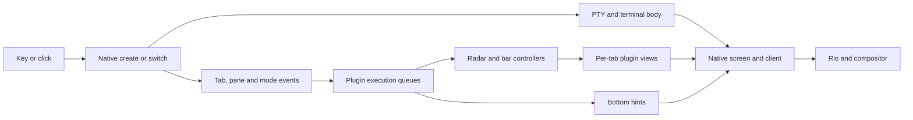

# Nova tab performance

Investigation: 2026-10-12. Scope: the Nova Edge desktop launcher on Linux.
The investigation owner is `yazelix-5vl-tab-performance-investigation-yia1`;
the first implementation owner is `yazelix-5vl-tab-mode-events-mbhl`;
the hints follow-up owner is `yazelix-5vl-hints-tab-work-jvpj`;
the native build-profile comparison owner is `yazelix-5vl-native-release-profile-4bea`.

Radar and Bar avoid repeated keymap decoding in mode events. Exact revision
`e52bcefa` passed Linux and native Darwin checks and is installed through the
user's Home Manager Edge desktop entry. Its fresh private-display launch passes
anima handoff, creation, numbered/walking switches and minor modes. The user
reports it is noticeably better; this is qualitative manual evidence, not a
latency measurement. The hints follow-up below is implemented but not installed.
Home Manager owns the desktop package; a separately named `yazelix-edge` profile
selector does not update it. Delivery proof:
`/home/lucca/.local/state/codex/proofs/nova-desktop-delivery-20261012.i_xj01jl/activation-ufqqy98k`.

## Native release-profile comparison

Owner: `yazelix-5vl-native-release-profile-4bea`. The native wrapper sets
`lto = true` and `codegen-units = 1` at the application root, matching pinned
Zellij's release optimization settings. [Cargo's profile rules](https://doc.rust-lang.org/cargo/reference/profiles.html)
make that root the effective owner; dependency-workspace profiles are ignored.
The control already uses release optimization level 3, 16 codegen units and
Cargo's local thin LTO. This is not a debug-to-release comparison.
[Wasmi's embedding guidance](https://github.com/wasmi-labs/wasmi/blob/main/docs/usage.md)
supports testing fat LTO and one codegen unit, but does not establish Nova latency.
Nix retains ownership of stripping; no plugin profile, compiler, engine or
dependency changes are combined with this experiment.

The control is exact Edge source `a6623698f18212f294c8fb6af1a91a4bd5157444`.
Both full Nix packages include the pending hints fix, so neither represents a
comparison against the user's installed `e52bcefa` desktop package. Rust is
1.96.0 and Wasmi remains 1.1.0. All 16 extracted embedded Wasm plugins are
byte-identical. Native inputs differ only in the wrapper source and output;
vendor derivations resolve to the same immutable vendor artifact.

Both packages were installed into isolated Nix profiles. Eight fresh terminal
sessions ran control/candidate/candidate/control, then the reversed order.
Every session retained 59 explicit bindings, native defaults and the full UI;
it created a second tab and ran eight numbered, eight walking and eight click
switches. The probe verified each server's executable through `/proc`.
No heavy builds overlapped the measurements. Host one-minute load ranged from
0.64 to 3.01 on 16 logical CPUs; background I/O pressure remained observable.

| Endpoint | Control | Candidate |
| --- | ---: | ---: |
| Native/package build wall time, one trial each | 6m27s | 9m50s |
| Stripped native executable | 76,362,024 bytes | 68,493,544 bytes |
| Fresh `enter` body, median (range), four sessions | 501 ms (486–512) | 430 ms (419–448) |
| New-tab body, median | 93 ms | 91 ms |
| Correct new-tab bar selection, median | 134 ms | 117 ms |
| All new-tab endpoints observed, median (range) | 275 ms (251–297) | 271 ms (237–279) |
| Numbered switch correct-bar median, 32 switches | 42 ms | 36 ms |
| Walking switch correct-bar median, 32 switches | 43 ms | 41 ms |
| Click switch correct-bar median, 32 switches | 54 ms | 51 ms |
| Observed live-thread CPU during ~3s after creation, median | 555 ms | 505 ms |
| Settled native-server CPU, median of twelve 2s windows | 0.5% of one core | 0.5% of one core |

Fresh terminal startup improved consistently by about 71 ms at the median
(14% for this endpoint), and the executable is 10.3% smaller. Keep the two
settings as a candidate for those benefits. The measured build cost increased
by 3m23s (52%); each variant was built once with warm dependencies, so this is
not a general clean-build prediction. Peak build memory was not measured.

New-tab completion and switch ranges overlap. Walking/click body medians were
slightly worse (control 26/31 ms, candidate 28/34 ms); the reversed run order did not
confirm a consistent walking/click improvement. There is no clear idle gain.
The CPU sums cover threads alive at the final sample, with 10 ms ticks; exited
threads can be absent. Executor-pool names do not identify individual plugin
callbacks. Do not interpret these samples as an overall UI speedup.

The startup clock begins after detached terminal launch dispatch; action clocks
begin before input dispatch. Captures include IPC/polling overhead and do not
prove presentation order. These two-tab fixtures use small histories; Rio
presentation, many tabs, long-lived sessions and Darwin performance remain
unmeasured. Shared production acceptance still requires exact Linux/Darwin gates.
The user's desktop remains on the manually improved Radar/Bar revision.

Local package, attached-tab-focus and bottom-hints checks pass. Flake evaluation
and all-system output shape pass; a full local `nix flake check` was not run.
The isolated installed Edge `launch` passes anima-to-workspace handoff, creation,
numbered/walking switches and minor modes through pinned private-display Kinestra.
Screenshots show populated Radar, Bar and hints. This is GUI correctness proof,
not a timed presentation comparison or manual desktop dogfood.

Proof, commands, inputs, raw captures and analysis:
`/home/lucca/.local/state/codex/proofs/nova-native-profile-20261013.0zf4p9r2`.
Control native SHA-256:
`7b47f2b2b136a27fd08e2eadab8a4afac56f2fc1b32c82605b3e933b8c649707`.
Candidate native SHA-256:
`ec19a96362ad2dc3978fe137663d6e2a14bde135f49e30e6ad849eef54effc6e`.

## Bottom-hints follow-up

Owner: `yazelix-5vl-hints-tab-work-jvpj`. The isolated
[lightweight event patch](prototypes/zellij-distribution/zjhints-lightweight-events.patch)
uses the existing SDK's `InitialKeybinds` for the complete catalog and keeps it
across lightweight metadata events. Either startup event order, remaps and an
empty replacement catalog are covered. Native reconfiguration remains the owner
of catalog delivery; there is no new SDK, dependency or Nova config field.

Nova's direct pane sets the existing `pipe_name` to `""`. This disables unused
compatibility broadcasts and the session subscription. It settles after actual
mode metadata arrives, including empty/base Locked output. Unset and custom
names retain the child's publication and compatibility retries. Focus state is
still tracked, but it redraws hints only when the host is descended into a guest.
Width, theme, mode and nested-session updates still request the relevant redraw.
Permission startup keeps the pane selectable until the permission result and
does not render hints before permission-gated metadata arrives.

Separable catalog/direct-pane/output-cache variants were built with Rust 1.96.0
against the existing installed native binary. The output cache was rejected:
both trials made ten derivations in ten renders, giving zero cache hits. Skipping
irrelevant redraws needs no derived-output state or invalidation framework.

Two final traced pairs retain all 59 explicit bindings and native defaults.
Each creates a tab, runs 24 numbered/walking/click switches, reloads a remapped
Alt+9 binding, and checks Pane/Normal hints and Radar's session identity.

| Diagnostic endpoint | Control | Candidate |
| --- | ---: | ---: |
| Settled hints mode payload | 88,936 bytes | 830 bytes |
| Mode events requesting redraw during settled switches | 24 | 0 |
| Completed hints renders in captured run | 294 | 10 |
| Compatibility publications | 588 | 0 |
| Session events delivered to hints | 144 | 0 |
| Separate catalog deliveries, including reload | 0 | 4 |

Counts describe captured trace prefixes, not an overall UI speedup. Native
forced renders can still derive hints; no output cache is claimed. The traced
candidate had one 17.1-second new-plugin startup outlier after its body appeared
in 160 ms; it eventually converged. Another candidate selected the new tab in
867 ms. Controls selected it in 423 and 898 ms. These instrumented trials had
system load 5.13–10.02 on 16 logical CPUs, with concurrent release archive I/O.
The outlier is retained; it cannot be silently excluded or attributed to disk
activity without evidence. The bounded production follow-up below checks
recurrence without changing deadlines.

### Uninstrumented Nix-plugin comparison

After the archive work and Nix build finished, a control/candidate/candidate/control
sequence used the production Nix Wasm for all three plugins. Hints were installed
in an isolated profile; candidate source matched the applied patch exactly.
The existing native package remained
`/nix/store/8ycc2pycq5wmqj7qp2h3gv6191f2r0xf-yazelix`. Each probe used explicit
file-plugin URLs and retained all 59 bindings plus native defaults.
There were no overlapping heavy builds; one-minute load was 5.33–7.39 on 16 CPUs.
Creation values share a clock started before dispatching the new-tab action;
they are not additional delays after the body. Switch values start before input.
Endpoints use separate captures; their polling times do not prove presentation order.

| Observed endpoint | Control, two runs | Candidate, two runs |
| --- | ---: | ---: |
| New-tab body | 166–181 ms | 130–136 ms |
| New-tab bar label | 433–560 ms | 186–193 ms |
| Correct new-tab bar selection | 437–565 ms | 172–197 ms |
| New-tab hints | 236–303 ms | 186–211 ms |
| New-tab Radar | 489–539 ms | 186–212 ms |
| Numbered switch correct-bar median | 103–119 ms | 40–46 ms |
| Walking switch correct-bar median | 103–129 ms | 46–51 ms |
| Click switch correct-bar median | 116–122 ms | 39–66 ms |

The 17-second outlier did not recur in these two candidate sessions; its cause
remains unresolved. Body-switch medians did not consistently improve: control
19–26 ms, candidate 24–41 ms across methods/runs. These are small Linux terminal
observations with polling and IPC overhead, not Rio presentation timings,
macOS performance, a latency guarantee or proof of a complete UI fix.

Measured hints package:
`/nix/store/aiy8mc85bk739fyh1j80zqrnfpp7wa0f-nova-zjhints-0.5.0`.
Wasm SHA-256: `5e8509f993e981e1c4ea59becb87e6ab5bbbda9dea6e55450697b89b734904bc`.
`production-analysis.json` records independent body/plugin/selection observations.

The Nix Wasm build and all 148 native renderer/model tests pass, including catalog
ordering, reload, empty/Locked readiness, default pipe retries, resize and nested
focus. Existing `bottom_hints` and `attached_tab_focus` checks pass against the
installed file-plugin fixture: every minor mode, fitting, popup/focus, hide/restore,
pane order and multiple/mirrored clients remain covered. A fresh uncached file
plugin displays its permission prompt, accepts a keyboard grant and renders
Normal/Pane hints. Flake shape and all-system output evaluation pass.
Full rebuilt-distribution,
installed-launcher, fresh private-display and exact Linux/Darwin acceptance
proof remain separate from these existing-native/file-plugin probes.

Raw source, variant identities, logs, snapshots, elapsed times and analysis:
`/home/lucca/.local/state/codex/proofs/nova-hints-performance-20261012.nm_auw6j`.
`ablation-analysis.json` preserves exploratory variants; `final-analysis.json`
preserves the final traced pairs and the negative startup result.

## Lightweight mode-event implementation

Follow-up owner: `yazelix-5vl-tab-mode-events-mbhl`. Radar
[`3ad74c18`](https://github.com/Yazelix/zj-radar/commit/3ad74c18e44cf97cdd8c6ea9121f93c5c7135dd0)
and zjstatus
[`8ccf986f`](https://github.com/Yazelix/zjstatus/commit/8ccf986f7d9b9c27f278d618db45d7b05fc95302)
subscribe to `InitialKeybinds` in their stateful roles. The pinned native host
then delivers bindings separately and omits them from frequent mode events.
Both ignore the separate keymap; Bar drops it before its permission queue.
Views, SDK versions, host floor, native keymaps and hints remain unchanged.

Two control/candidate pairs retain all 59 explicit bindings plus native defaults.
Each fresh session creates a second tab and exercises eight numbered, eight
walking and eight click switches. Matching compiler versions are Rust 1.96.0
for Radar and 1.95.0 for Bar; hints use the same original artifact in both.
There are no overlapping heavy builds; one-minute system load is 3.25–3.64
on 16 logical CPUs. Callbacks are instrumented, so these are diagnostic timings.

| Endpoint | Control | Candidate |
| --- | ---: | ---: |
| Settled mode payload, both controllers | 88,936 bytes | 830 bytes |
| Radar settled decode median per run | 72.4–81.7 ms | 0.75–0.78 ms |
| Bar settled decode median per run | 40.1–44.1 ms | 0.74–1.00 ms |
| New-tab body | 158–163 ms | 154–157 ms |
| New-tab correct bar | 416–468 ms | 392–427 ms |
| New-tab Radar | 517–672 ms | 481–502 ms |
| Switch correct-bar medians across kinds/runs | 103–126 ms | 94–114 ms |
| Worst observed correct-bar switch | 212 ms | 167 ms |

Each controller receives a separate keymap at startup and reload; mode events
stay below 1 KB even across style and minor-mode changes. The reloaded Alt+9
binding, Pane/Normal hints and Radar's published session name pass assertions.
The attached-client check observes Pane/Normal mode output separately for each
client, full keymap reload, click targets at three widths, independent selection,
detach and reattach. Radar's 1,013 tests and Bar's 34 Wasm tests pass.
An initial Radar setup-test failure was caused by OpenCode on PATH; the suite
passes with the expected isolated PATH. Bar binary tests use its Wasm runner.

Raw proof, hashes, commands, event records and analysis:
`/home/lucca/.local/state/codex/proofs/nova-light-mode-20261012.gwbR4tSP`.
Use `candidate-3/4` and `control-3/4` for matched timing comparisons; earlier
controls use a different Bar compiler and are retained only as exploratory proof.
The unchanged hints path and shared-host variation still limit overall gains.
These measurements exercise `enter`, not Rio presentation.

### Installed candidate comparison and delivery proof

An isolated profile installed from Nova `d372ddd0e9c8c7f76d81b52d9bee3bec4f68f7a8`
resolves to `/nix/store/8ycc2pycq5wmqj7qp2h3gv6191f2r0xf-yazelix`.
Its native SHA-256 is
`8ff52a09b840af73d9609a2b87fd9d138b6725b6a12b2fccfea718d6b7ecf24f`;
dumped embedded Radar/Bar hashes match the pinned child Nix outputs.
The implementation revision `6f2cb002` and combined candidate `d372ddd0`
have identical Edge/default/native derivations.

Two uninstrumented control/candidate pairs use the full configuration, two tabs
and 24 switches each. No heavy builds overlap; one-minute load is 2.91–3.55 on
16 logical CPUs. Timings include native input/capture overhead, not Rio presentation.

| Endpoint | Original desktop artifact | Candidate |
| --- | ---: | ---: |
| New-tab body | 122–130 ms | 122–146 ms |
| New-tab correct bar | 1,158–1,316 ms | 450–773 ms |
| New-tab Radar | 1,539–1,768 ms | 877–977 ms |
| New-tab hints | 1,319–1,519 ms | 497–685 ms |
| Switch correct-bar medians across kinds/runs | 243–285 ms | 156–195 ms |
| Worst observed correct-bar switch | 587 ms | 391 ms |

A fresh automated private-display Kinestra run exercises the installed `launch`
path: anima → folder picker → Ctrl+O → managed Helix with a project marker,
then tab creation, numbered/walking switches and Pane/Normal modes. It passes
in 18.5 seconds; snapshots still show a partial UI during convergence.
This proves interaction correctness, not GUI latency or manual dogfood.

Exact-candidate `attached_tab_focus`, `bottom_hints`, flake evaluation and
all-system flake shape checks pass locally. A complete local flake check was
stopped when it began a separate upstream Rio build; it is not a passing check.
Required exact-revision Linux CI and Darwin Package Smoke remain tracked in
the owning Bead. No Main/Stable promotion or user desktop activation is claimed.

Installed identities, comparisons and GUI proof are in `installed-profile.json`,
`embedded-identities.json`, `installed-performance.json` and `gui-final.json`
under the implementation proof directory above. The review's direct-mode and
negative checks are in
`/home/lucca/.local/state/codex/proofs/nova-mode-review-20261012.x7x33fct`.
Skipping mode entry passes the old check and fails the revised check; its normal
run and both unit tests pass against the installed candidate.

## Original investigation

The remaining measurements and source pins describe the original desktop
artifact and temporary prototypes. They explain the chosen change and remaining
options; they are not measurements of the final candidate. The reproduction
bypasses Rio, so Rio is not required to produce the blank UI. Its contribution
to desktop latency remains unmeasured.

### Report and observable behavior

The user reports slow tab creation, horizontal walking, numbered switching, and
clicking tabs, and uses the **Nova Edge desktop entry**. The supplied screenshot
shows a running folder picker with 189 entries, a top bar containing `…`, an empty
bottom row, and a sidebar containing only `Radar`.

Our reproduction shows the same intermediate UI with a tiny disposable home and
empty or one-entry directory history. A large zoxide history is therefore not a
prerequisite. This does not exclude extra picker cost with the user’s history.

For this investigation, retain Nova’s existing tab contents, focus policy, Radar,
top-bar interactions, and hints. A successful optimization must shorten the
delay without losing those behaviors. No numerical latency guarantee has been
accepted. Record these endpoints separately:

| Endpoint | Observation | What it does not establish |
| --- | --- | --- |
| Native tab creation | New stable tab/pane IDs exist | Visible content or plugin readiness |
| First terminal body | Target Yazi/picker or unique terminal marker appears | Input echo, correct bar/Radar, GUI presentation |
| First plugin frame | Bar labels, Radar rows, and hints replace placeholders | All three agree with the current selection |
| Completed switch | Target body and active tab highlight agree | Rio/compositor presentation or every sidebar field |
| Input acknowledgement | A harmless input produces its expected response in the target | Not measured in the creation probes |

### Original installed artifact

The desktop entry uses an absolute executable path. It does not resolve `yzx`
through the interactive shell’s PATH.

| Surface | Identity at inspection |
| --- | --- |
| Desktop file | `/home/lucca/.nix-profile/share/applications/yzx-edge.desktop` |
| Desktop command | `/nix/store/s44slycskycw0lw8z6v0k7362970mr7w-yzx/bin/yzx launch` |
| Native binary | `/nix/store/y4yr7icvy91268cqjjndjvczblzi3p5m-nova-zellij-distribution-0.1.0/bin/yzx-zellij` |
| Native SHA-256 | `509634058144474e44431d48707cdaf0920694a3f03bba9026c1cbb32f76b3ad` |
| Runtime identity | Nova 1.3.0, channel `edge`, Rio `aead5c08d1d5b8396fedf1038b609144b93cbe4c` |
| Source checkout | `edge`, `9942aeabd160855325806a5fd310ef2de088a225` |

The native hash matches the installed-artifact proof recorded for `15fcdef1`.
The runtime identity file does not itself expose Nova’s full source revision.
Do not infer artifact identity from the current checkout or version number alone.
There is also a portable installation on PATH; these measurements use the Nix
artifact named above.

Read-only inspection of the running Rio session found the default Radar choice
and `/home/lucca/.local/share/yazelix/zellij/config.kdl`, with 371 physical lines
and 50 `bind` lines. The disposable baseline contains 49 `bind` lines. We have
not copied the user’s complete configuration or session into the probes.

## Paths through the system

The bindings in [config.kdl](defaults/zellij/config.kdl) distinguish the triggers:

| Trigger | Owner before the shared native switch/create path |
| --- | --- |
| `Alt Shift T`, tab-mode `n` | Native `NewTab`, installed layout, home cwd |
| `Alt 1`…`Alt 9` | Native `GoToTab` |
| `Alt h/l`, left/right | Pane orchestrator: focus a pane or cross a tab boundary |
| Top-bar tab click | Bar view → bar controller → native action |
| Radar row click | Radar view → Radar controller → native action |
| `Ctrl Tab`, `Ctrl Shift Tab` | Radar cross-session cycling; a separate operation |

Horizontal movement may focus the sidebar before changing tabs. The synthetic
walking check starts in the rightmost work pane and uses `Alt l`, then asserts
the target body. It does not count a successful sidebar focus as a tab switch.

The [layout](defaults/zellij/layout.kdl) creates three plugin panes per tab:
top bar, Radar view, and bottom hints. Background controllers also remain alive.
New tabs start managed Yazi with `--yzx-startup-picker`. The top-level welcome
animation does not run for each new tab.



The observed gap lies between the first body and the completed plugin UI.
The diagram describes ownership, not a claim that these branches execute in
strict sequence.

## Original measurements

Proof directory on this workstation:
`/home/lucca/.local/state/codex/proofs/nova-performance-20261012.mtW9Bi5s`.
It contains harness source, CSV samples, configurations, terminal captures,
isolated native logs, and per-thread CPU samples. Raw proofs are local artifacts;
the observations and constraints needed for later work are recorded here.

### Installed launcher, one tab followed by a second tab

The probe starts the exact installed `yzx enter --session perf-launcher` inside
a private tmux server, waits for the first Yazi body, settles for two seconds,
and sends `Alt Shift T`. It isolates HOME, config, state, session cache, sockets,
temporary logs, and directory history. It uses 120×40 terminal cells and captures
the target body and the top bar independently. The temporary socket path stays
below the platform limit. No input or launch touches the user’s desktop/session.

Times below start before sending the key. They include tmux input/capture cost
and polling, so they are observations with measurement overhead.

| Probe | First target body, ms | First bar with tab 2, ms | First Radar rows, ms |
| --- | ---: | ---: | ---: |
| Default, `key-1` | 124 | 1,248 | 1,719 |
| Default, `key-2` | 120 | 1,164 | 1,622 |
| Radar disabled, `key-no-radar-1` | 147 | 852 | Absent |
| Radar disabled, `key-no-radar-2` | 87 | 507 | Absent |
| Keymap reduced after startup, `key-minimal-1` | 137 | 1,089 | 1,511 |
| Keymap reduced after startup, `key-minimal-2` | 141 | 967 | 1,340 |

The first separate reproduction (`launcher-enter`) recorded body 125 ms and bar
1,293 ms. Its quarter-second capture matches the supplied screenshot’s blank
plugin UI. Captures at one, three, and ten seconds distinguish delayed convergence
from a persistent missing view.

Radar-off uses the existing sidebar configuration with `/bin/sleep 9999` in
place of Radar. Nova omits Radar’s controller and view. Geometry remains similar,
but the replacement is a terminal pane, so this is a component ablation rather
than an identical-work comparison. Default/Radar-off order was A–B–B–A.

The keymap experiment rewrites only the disposable native config after startup,
retaining tab creation and two numbered bindings. The bottom-hint capture confirms
reload to `{A} 12 tab {A-S} T new`. Most of the real-launcher delay survives.
This probe does not record payload sizes received by newly loaded instances.
The later trace controls the keymap before the first plugin loads and measures
those sizes directly. Do not propose pruning the user's bindings as the fix.

Single additional new-tab probes, using the installed session’s environment and
a custom layout, recorded:

| Layout variation | First bar, ms | First Radar rows, ms |
| --- | ---: | ---: |
| All three views | 1,321 | 1,433 |
| Omit new tab’s hints | 1,020 | 709 |
| Omit new tab’s Radar view, retain controller | 1,233 | Absent |
| Omit new tab’s bar view, retain controller | Absent | 710 |

These single samples suggest interaction among plugin views and controllers.
They do not isolate one expensive callback. One Radar-view-omitted probe used
the wrong body predicate when the real folder picker opened; its bar observation
survives, but its body latency is excluded.

### CPU during creation

The probe samples `/proc/<own-server-pid>/task/*/stat`; `CLK_TCK` is 100.
These are deltas for the isolated native server, not lifetime `ps` percentages
and not Rio or whole-session CPU. Over the first three seconds after creation:

| Probe | CPU seconds in busiest plugin execution threads |
| --- | --- |
| Default, `key-1` | 1.89 + 1.44; other plugin threads 0.16 + 0.24 |
| Default, `key-2` | 1.80 + 1.33; other plugin threads 0.15 + 0.20 |
| Radar disabled, run 1 | 0.95 + 0.87 + 0.83 |
| Radar disabled, run 2 | 0.47 + 0.52 + 0.76 |

The two busiest baseline workers each accumulate about 0.73 CPU seconds within
the first 0.75 wall seconds. This is evidence of substantial computation during
the gap. Executor threads can host several plugins; their names do not identify
an individual plugin’s CPU share. These measurements do not establish idle CPU.

### CPU profile and completed switching

`profile-full` records a three-second `cpu-clock:u` profile at 199 Hz, attached
only to the disposable server during creation. `perf` captured 795 samples with
zero lost samples. The flat profile puts 53.96%, 30.44%, 3.40%, and 3.27% in
`wasmi::engine::executor::instrs::execute_instrs` on four plugin workers, totaling
91.07% of sampled native user CPU. Call graphs place most of that work under
`apply_event_to_plugin`, with a smaller pipe-message contribution. This identifies
interpreted plugin callback execution; it does not identify the Wasm function or
separate SDK decoding, update logic, and callback-driven rendering.

After ten seconds of convergence, the same session alternates between its two
tabs using numbered keys, `Alt l`, and top-bar clicks. Each observation waits for
both the target body and the correct ANSI-colored active tab label. It leaves
100 ms after completion before the next input. Each method has eight samples:

| Method | Body median / maximum, ms | Correct bar median / maximum, ms |
| --- | ---: | ---: |
| Numbered keys | 19.4 / 28.2 | 338.2 / 833.7 |
| Horizontal walking | 20.8 / 127.5 | 296.8 / 829.1 |
| Top-bar click | 27.9 / 148.2 | 324.2 / 793.0 |

The body and bar columns measure the same inputs. The bar often updates later
when returning to the first tab; the callback trace below identifies extra
controller mode-event delivery in that direction. Queue waiting is unmeasured.
The profiler had finished before this switch series. The host remained busy,
so repeat the series under controlled load before setting a latency target.
The check verifies active-bar selection, not full Radar/hints agreement.

Commands used for the saved proof on this workstation; the probe exercises
`enter` and records native output:

```sh
rustc --edition=2024 /home/lucca/.local/state/codex/proofs/nova-performance-20261012.mtW9Bi5s/profile.rs -o /home/lucca/.local/state/codex/proofs/nova-performance-20261012.mtW9Bi5s/profile
/home/lucca/.local/state/codex/proofs/nova-performance-20261012.mtW9Bi5s/profile /home/lucca/.local/state/codex/proofs/nova-performance-20261012.mtW9Bi5s/profile-full /nix/store/s44slycskycw0lw8z6v0k7362970mr7w-yzx/bin/yzx key-profile
```

The harness uses the repository’s `checks/tmux.rs` and the active-highlight
parser from `checks/attached-tab-focus.rs`. Saved source and the installed store
paths are part of the proof identity. Recheck them before comparing another
revision, and choose a fresh destination when repeating to preserve the proof.
Inspect `perf.stderr` and `PERF_EXIT` instead of assuming profiling
permissions or successful collection on another host.

### Synthetic bodies and more tabs

An earlier matrix uses the installed native binary and config with marker/sleep
terminals instead of Yazi. It compares native-only, Radar-only and bar-only graphs
at 3 and 12 tabs. Each numbered series has 16 observations; creation has four.
Creation uses a native CLI action and measures the first marker, not full UI.

| Graph | Initial tabs | Numbered body switch median, ms | New body median, ms |
| --- | ---: | ---: | ---: |
| Native only | 3 | 20.8 | 61.6 |
| Native only | 12 | 18.7 | 76.8 |
| Radar only | 3 | 20.3 | 59.7 |
| Radar only | 12 | 21.0 | 73.0 |
| Bar only | 3 | 20.5 | 63.1 |
| Bar only | 12 | 20.8 | 69.0 |

Those similar body timings do not clear Radar or the combined plugin graph.
Combined runs switched bodies while the bar still displayed `…`. Early click
samples without a ready bar produced long tails and missing-target assertions;
they are excluded from component comparisons. A longer isolated observation
showed recovery. A synthetic reduced-keymap run also reduced a walking tail,
but neither synthetic body timings nor that post-startup config edit establish
the cost of full payloads in newly loaded plugins.

## Original source evidence and competing mechanisms

The investigation reads pinned source, rather than divergent sibling checkouts:

| Component | Pin |
| --- | --- |
| Radar | `9beefdf9a997a9a0b206d40cccc57d4eba76a9de` |
| Pane orchestrator | `f47af17470c70cd9d8b0422222105995d074fc04` |
| Nova Bar | `7295e9976803de8d912f766f1b00ad12652e3e9b` |
| zjstatus used by Bar | `0338e5eaef2316ce6776237ae2c2d17cc4112859` |
| Native Zellij | `333d7898a840314e41d3cc9d2a264a1b9732bb7b`, plus local distribution patches |
| Bottom hints | `709d56292217920a5b7e2702302cd66b60ed6477`, plus local grouping patch |

**Radar has one controller and thin views.** View instances subscribe to mouse
and permission events, not the full state/timer stream. The controller sanitizes
and deduplicates tab updates and gates several snapshot/presence writes.
Its timer adapts between 200 ms animation, one-second bookkeeping, and a
60-second quiet heartbeat. A claim that every tab runs a full polling Radar
engine would contradict this pin.

**Radar still sends frames to registered inactive views.** `publish_views`
renders once per distinct size, then clones and sends a frame to each registered
view. Neither that seam nor view-frame receipt checks equality with the last
frame. Delivery work grows with registered views even when rendering shares a
size cache. View registration and permission/size ordering also matter for the
first frame. See [Radar plugin source](https://github.com/Yazelix/zj-radar/blob/9beefdf9a997a9a0b206d40cccc57d4eba76a9de/crates/plugin/src/lib.rs).

**The top bar has similar fan-out plus a one-second refresh.** Its controller
sets `should_render = true` on each timer event and publishes to all registered
views, sharing rendering by width. `render_frame` clones state/widget maps.
A new bar view prints `…` while its frame is empty and requests a frame after
permission/width readiness. Thus `…` identifies a view without a usable frame;
it does not measure terminal startup. See [zjstatus](https://github.com/Yazelix/zjstatus/blob/0338e5eaef2316ce6776237ae2c2d17cc4112859/src/bin/zjstatus.rs).

**Mode events contain potentially expensive unused keymaps.** Native
`apply_event_to_plugin` includes keybindings in `ModeUpdate` unless the plugin
subscribes to `InitialKeybinds`. Radar and Bar use SDK 0.44.3; Radar consumes only
the session name from this event, and Bar clears keybindings after SDK decoding.
Hints needs the bindings and does not subscribe to `InitialKeybinds` at this pin.
The later callback trace measures this cost directly. `InitialKeybinds` exists
in both installed SDKs, so adopting it does not itself require an SDK upgrade.
Preserve hints' cached bindings across lightweight mode events and refresh them
on configuration changes. The pinned native bridge sends initial bindings and
notifies subscribers again after reconfiguration; this needs a regression check.
See the [event contract](https://zellij.dev/documentation/plugin-api-events.html#initialkeybinds).

**Native pane/tab/mode delivery filters inactive tab plugins.**
`screen.rs::targeted_plugin_ids` selects active-tab plugins and subscribed
background plugins for these events. Controller frame pipes to inactive views
use a different path. The switch path still generates full pane/tab/session
state, reconciles focus, reports plugin metadata, and schedules rendering.

**Session updates still broadcast to all subscribers.**
`log_and_report_session_state` sends `SessionUpdate` without a plugin/client
target. Each hints instance subscribes to it, including on inactive tabs, but
the pinned hints `update` function has no `SessionUpdate` handler. The SDK must
decode the payload before that function can ignore it. This is a concrete
candidate for removing unused work. Its runtime contribution needs measurement;
the active-tab filtering above does not cover this event. Inspect the pinned
[hints source](https://github.com/myah-mitchell/zjhints/blob/709d56292217920a5b7e2702302cd66b60ed6477/src/main.rs)
and Nova’s [local patch](prototypes/zellij-distribution/zjhints-group-modifiers.patch).

**Plugin execution has queues, shared workers, and locks.** Native plugin jobs
run through a pinned executor, with per-plugin locking and up to 16 threads on
this host. Plugin loading holds the plugin map lock while initializing an
instance. Event handling serializes protobuf, calls Wasm, and may render/send
bytes. Some controllers and newly registered views can share a worker. CPU
samples establish pressure here; the later callback trace separates some
event/render work but does not measure lock or queue waiting.
See [native bridge](https://github.com/zellij-org/zellij/blob/333d7898a840314e41d3cc9d2a264a1b9732bb7b/zellij-server/src/plugins/wasm_bridge.rs).

**Orchestrator reconciliation is another boundary, not a universal sleep.**
It joins tab and pane snapshots and has a 500 ms recovery timer. Once ready,
horizontal movement plans and issues the native focus/tab action directly.
Do not describe the timer as a fixed delay on every keystroke. Its status
publication also has equality gates. See [orchestrator](https://github.com/Yazelix/zellij-pane-orchestrator/blob/f47af17470c70cd9d8b0422222105995d074fc04/src/main.rs).

**Yazi has separate startup costs.** [yzx-yazi](runtime/yzx-yazi.rs) queries
configuration, materializes config, checks terminal size, and starts Yazi.
Its size loop has a two-second deadline, not an unconditional two-second sleep.
The [startup picker](defaults/yazi/plugins/quick-search.yazi/main.lua) queries
zoxide and may start fzf. These costs affect creation; they do not explain why
already-rendered picker content precedes several other plugin frames.

## Further findings and improvement options

Upstream's [Wasmtime-to-Wasmi migration](https://github.com/zellij-org/zellij/pull/4449)
traded compilation/cache machinery for interpretation and documented a cost for
compute-heavy plugins. A later [0.44.x issue](https://github.com/zellij-org/zellij/issues/5291)
reports high idle CPU with built-in bars. That report concerns a different
revision and plugin graph; it does not prove Nova has the same bug. Our profile
measures a creation interval, not settled idle behavior.

### Build profiles do not match upstream

The exact installed native derivation uses
`/nix/store/xdxqlfk3fmqh1gg24kkwhv6dn3wjfy5g-zellij-distribution/Cargo.toml`.
That wrapper has no release profile. Upstream's pinned workspace explicitly sets
`lto = true` and `codegen-units = 1`. Cargo ignores profiles in dependencies;
the installed derivation has no profile/Rustflags override. Nova therefore
does not inherit those upstream settings. This is still an optimized release
build, not a debug build. See the [Cargo profile rules](https://doc.rust-lang.org/cargo/reference/profiles.html).

Wasmi recommends fat LTO and one codegen unit for its embedding application.
Its interpreter is generic, so optimizing only the `wasmi` dependency can miss
the code instantiated in its consumer. See the [Wasmi optimization guide](https://github.com/wasmi-labs/wasmi/blob/main/docs/usage.md).

Hints also has no release profile. Radar already has LTO and one codegen unit,
but chooses size optimization (`opt-level = "z"`). Bar already has fat LTO and
one codegen unit. These are different cases; applying the same changes to all
plugins would obscure which setting helps. None of the proposed build-profile
changes has been benchmarked here.

### Callback tracing identifies expensive work

Temporary builds expand each pinned SDK's registration macro to time stdin/JSON
reading, protobuf decoding and event conversion before `State::update`, then
time that update separately. Pipe decoding/handling and render callbacks have
separate timers. The native binary and engine remain installed artifacts; Radar,
Bar and hints load from explicit candidate Wasm files in a disposable graph.
Permission grants and pane URLs identify the actual instances. Config/layout
paths and aliases are explicit. No compiled candidate was installed for the user.

These are elapsed callback times, including host calls and scheduling, not CPU
samples or enqueue-to-start times. Instrumentation adds clock/logging overhead;
file-plugin loading and worker assignment can differ from embedded plugins.
Use the trace to identify work, not to claim an absolute desktop speedup.

`plugins-trace-full-2` records an **89,496-byte protobuf ModeUpdate** each time
the full mode/keybind payload is delivered. During its first three seconds:

| Consumer | Calls | Decode/conversion per call, ms | Plugin update per call, ms |
| --- | ---: | ---: | ---: |
| Radar controller | 2 | 87.6–119.9 | 2.20–2.29 |
| Bar controller | 2 | 38.5–43.6 | 1.34–1.46 |
| Hints, both tabs | 4 | 46.8–72.7 | 0.005–6.69 |

The separate `plugins-trace-1` observes Radar decoding 140.1 ms before a 2.3 ms
update. Radar consumes only the session name, and Bar discards the decoded
keybindings. Optimizing agent classification alone would miss this cost.

In the full second trace, hints performs **33 renders** during those three
seconds, taking 620 ms in aggregate across its two instances. During 24 settled
switches it performs another 216 renders. Their median durations are 12.5 and
17.1 ms for the two instances. These sums can overlap across workers and are
not the critical-path wall time.

The switch trace also explains the observed direction asymmetry: returning to
tab 1 delivers full mode events to hints, Radar's controller and Bar's controller;
switching to tab 2 delivers one to its hints instance. Native tab activation
reports mode information to that tab's plugin IDs, including suppressed panes.
The controllers are suppressed panes associated with tab 1 in this graph. This
is a narrower observation than claiming every background event reaches every
tab's plugins.

A diagnostic with three binding rules configured **before startup** reduces
that payload to 1,582 bytes. Settled mode-event decoding medians change from
79.2 to 4.5 ms for Radar, 42.9 to 1.3 ms for Bar, and roughly 58–60 to 1.8–2.1 ms
for hints. Hints render medians fall to about 1.4 ms because the hint catalog is
also smaller. Correct-bar switch medians across numbered/walking/click methods
are 111–122 ms with the full map and 40–41 ms with the diagnostic map.

This is one instrumented run per map, with eight switches per method. It proves
the payload/catalog is expensive in this environment; it does not isolate
decoding from hint generation or retain the user's full keymap. Production
should deliver/cache bindings through `InitialKeybinds` and avoid rebuilding
unchanged hints while preserving all bindings. The earlier post-startup keymap
probe is not sufficient to reject this mechanism.

Saved proof: `plugins-trace-full-2`, `plugins-trace-min-2`,
`plugins-trace-analysis.json`, `analyze-plugin-trace.py`, candidate sources,
locked build logs and Wasm artifacts. `plugins-trace-1/native.log` ends at its
ten-second snapshot and supports creation timing only; the later trace saves
logs after the switch series too.

### Full-keymap Radar prototype

A separate temporary Radar build changes only the controller's subscription to
include `InitialKeybinds`, retaining its trace instrumentation. The current
0.44.3 SDK compiles it without an upgrade. The installed native host sends the
full keymap once and omits it from subsequent mode events. Radar does not use
the map. The full configuration, Bar and hints remain unchanged.

`plugins-trace-radar-keybinds-1` verifies an 830-byte Radar mode event while
Bar and hints still receive 89,496 bytes. Across 12 settled Radar mode callbacks,
median decode/conversion is 0.75 ms, compared with 79.2 ms in the full-map
control; its update median is 0.020 ms. Both runs exercise 24 switches across
numbered keys, walking and clicks. Body and correct-bar assertions pass, and
pane metadata identifies the actual candidate.

Correct-bar switch medians remain 114–131 ms versus 111–122 ms in the control.
Creation records body 159 ms, Bar 433 ms and Radar 492 ms. This is one run per
variant, not a latency acceptance. It shows that removing Radar's repeated
decode work is insufficient while Bar/hints retain theirs. Initial keybind
delivery still costs work once, and reload, cross-session and multi-client
behavior have not been dogfooded. Saved original/candidate Wasm files and source
delta preserve the comparison in the proof directory.

### Hints requests renders until a mode change

The installed hints source starts `update` with `should_render = !initialized`.
Its render function sets `initialized` only when it has nonempty output and
the current mode differs from the base mode. A normal-mode session can therefore
keep that flag false even after showing valid hints. Ignored session updates
then request another render. This is direct source evidence, separate from the
cost of decoding their unused payloads.

A disposable prototype removes the unused subscription and marks hints ready
when keybindings are available. Its control is the same pinned, locally built
source without those two changes. Both use the same Rust toolchain, release
profile, permission grants, layout and native binary. Each fresh session runs
the installed `enter` launcher with an explicit test layout; creation uses a
native CLI action. Both tabs use the candidate Wasm file, verified through pane
metadata, and the initial capture contains working hints rather than a permission
prompt. These are plugin experiments, not installed-distribution acceptance.

| Order | Hints variant | New body, ms | Bar, ms | Radar, ms |
| --- | --- | ---: | ---: | ---: |
| A1 | Original | 172 | 1,150 | 1,235 |
| B1 | Ready flag + no session subscription | 175 | 1,070 | 1,296 |
| B2 | Ready flag + no session subscription | 152 | 336 | 411 |
| A2 | Original | 157 | 1,407 | 1,525 |

The modification does not consistently remove the gap. Correct-bar switching
medians across the three input methods were 244–278 ms in the controls,
212–231 ms in B1, and 93–100 ms in B2, with eight observations per method/run.
Keep the improvement as a candidate; do not claim a reliable percentage from
two variable runs. Individual effects of the two changes remain unseparated.
Proof: `hints-ablation-summary.json` and the four `hints-valid-*` directories.
Earlier permission/fixture failures are excluded; one control's final log-count
assertion was replaced by a successful pane-metadata check because module-cache
reuse does not emit a second module-load line.

### Unused hints broadcasts amplify rendering

Hints' default render publishes the same output under both `zjhints` and
`zjstatus_hints` compatibility pipe names. These messages have no destination
plugin ID. Nova displays hints directly in a pane and its bar configuration
consumes neither pipe. Nevertheless, Bar's pipe parser stores every received
value and returns `true`, including unchanged values for unused pipes. The
controller then publishes frames to all registered views. Radar and the view
instances also decode the broadcasts before ignoring them.

In `plugins-trace-1`, the first three seconds include 30 hints renders, 63 pipe
deliveries each to Radar and Bar's controllers, and 270 deliveries to the two
Bar views. Those views perform 145 renders. The source explains the amplification:
two broadcasts per hints render, then additional controller-to-view frames.
This path can grow with inactive tabs; no large-tab scaling claim is measured
by this two-tab trace.

Disabling publication in a temporary hints build retains its visible pane,
keybindings, initialization behavior and session subscription. This isolates
the unused compatibility output from the earlier readiness/subscription changes.
The ordinary child default must remain available for users who consume those
pipes; Nova needs an explicit opt-out rather than silently changing their
contract. Alternatively, rejecting unchanged/unused pipe values in Bar reduces
republication but leaves broadcast decoding elsewhere.

The original control and no-broadcast candidate ran in A–B–B–A order:

| Order | Hints variant | New body, ms | Bar, ms | Radar, ms |
| --- | --- | ---: | ---: | ---: |
| A1 | Original | 157 | 1,407 | 1,525 |
| B1 | No compatibility broadcasts | 164 | 387 | 444 |
| B2 | No compatibility broadcasts | 160 | 1,249 | 1,336 |
| A2 | Original | 166 | 669 | 1,082 |

Correct-bar switch medians across the three methods were 242–278 ms in the
controls, 111–124 ms in B1, and 254–282 ms in B2. This change removes a confirmed
unused message path, but these timings do not establish a consistent latency
improvement or a complete fix. Shared-host load and executor assignment remain
confounders. Proof: `hints-broadcast-ablation-summary.json`,
`hints-no-broadcast-{1,2}`, and `hints-valid-base-{3,4}`.

### Upstream already owns shared plugin instances

Zellij merged [resource usage optimizations, PR #5662](https://github.com/zellij-org/zellij/pull/5662)
on 2026-09-28, before Nova's 2026-10-09 native pin. That pin contains
`ZellijSharedPlugin`, `register_shared_plugin!`, slots and client context.
The native host deduplicates equal mode/tab/pane events before calling a shared
instance, merges render requests, and renders visible slot/client targets.
The implementation is in pinned `zellij-tile/src/lib.rs` and
`zellij-server/src/plugins/shared.rs`.

Radar and Bar currently implement their own controller/view fan-out; hints is
instantiated per tab. They do not opt into this API. Updating the native pin
alone therefore cannot remove their instances or message protocol. Migrating
a plugin could replace that protocol with native slot ownership. This requires
SDK and child compatibility decisions, not just a layout flag. Radar's declared
0.44.3 host floor cannot silently be dropped.

There is also a decoder difference: the legacy registration macro parses a
JSON array of protobuf bytes, then decodes and converts the event. The current
shared macro uses `protobuf_bytes_from_stdin` and `event_from_protobuf_bytes`
instead. A newer SDK alone leaves the legacy macro path in place. Measure any
decoder benefit separately from instance deduplication and render batching.

### Options, in the order I would evaluate them

| Option | Owner and concrete change | Expected value | Cost and proof boundary |
| --- | --- | --- | --- |
| Remove avoidable plugin work | Radar/Bar `InitialKeybinds` is installed; hints catalog, unused broadcasts and readiness/subscriptions are implemented above | Reduces decoding and render amplification while retaining the UI | Hints acceptance is pending. Output caching was rejected. Preserve reload, nested sessions and compatibility-pipe consumers. |
| Restore native release optimizations | Native root fat LTO and one codegen unit are measured above; no hints profile change | Consistent fresh terminal-startup gain and smaller executable; tab-creation/walking benefit remains uncertain | Two Cargo settings, 3m23s longer measured build. Shared acceptance is pending exact Linux/Darwin proof. |
| Adopt native shared instances | Migrate one expensive plugin to `ZellijSharedPlugin`; delete its controller/view protocol when equivalent | Removes per-tab Wasm initialization, frame messages and duplicate state delivery through an existing host owner | Medium to large child change. Prove client-local selection, slot lifecycle, resize, click targets and compatibility policy. |
| Reduce legacy frame fan-out | Radar/Bar: skip unchanged frames, use visibility, refresh immediately on activation | Less pipe decoding and rendering, especially with many tabs | Medium. Equality must include interaction targets. Prove first frame, activation and multiple clients. Avoid building a second visibility owner if migrating to shared instances. |
| Upgrade Wasmi | Native Zellij: evaluate Wasmi/WASI 2.x with correct features | Faster interpreter without replacing the plugin model | Medium upstream/fork work. Nova pins 1.1.0; migration is not a version-only edit. Upstream benchmark gains do not predict Nova latency. |
| Use a smaller UI graph | Existing configuration can replace Radar; optionally evaluate omitting hints | Immediate reduction in plugin work | Loses visible functionality. Radar-off still left 0.51–0.85 s bar delay. This is a user-selected tradeoff. |
| Compiled Wasm engine | Native host: evaluate Wasmtime with build-time compilation or caching | Potentially reduces sustained callback execution cost | Large engine, packaging and maintenance change. Keep behind evidence from the cheaper options. |

The [Wasmi 2.0 release](https://github.com/wasmi-labs/wasmi/releases/tag/v2.0.0)
reports roughly 2.2× geometric-mean execution improvement on its benchmark suite.
Its [migration guide](https://github.com/wasmi-labs/wasmi/blob/v2.0.0/docs/migration-v1-to-v2.md)
covers changed resource limits, WASI and feature selection. Nova's native
dependency disables default features; a migration must deliberately retain
validation and select the intended dispatch path. No Wasmi 2.x Nova candidate
has been built or measured.

Wasmtime documents [precompilation](https://docs.wasmtime.dev/examples-pre-compiling-wasm.html)
and [caching/Winch](https://docs.wasmtime.dev/examples-fast-compilation.html)
as ways to control compilation latency. Precompiled artifacts require matching
engine configuration and trusted provenance; external plugins need an explicit
loading policy. This would enlarge the native fork and require Linux/macOS
delivery proof. A general engine benchmark is not proof that this change beats
fixing redundant callbacks in Nova.

## Next experiment and decision boundary

Finish exact-revision acceptance of the hints and native-profile candidates
before choosing one plugin's shared-instance prototype. Hints output caching
has been rejected; the native profile comparison remains separate from plugin
changes. Retain the full keymap/UI
and test reload, minor modes, nested sessions, permission startup, tab closure and
multiple clients alongside creation and all three switch methods.

The remaining trace gap is native queue waiting and presentation. Correlate
action receipt, plugin enqueue/start/end, worker/lock waiting, view registration,
frame send/receipt and client output using stable IDs and monotonic timestamps.
Use private Kinestra for Rio presentation. Do not interpret elapsed callback
sums as critical-path wall time or add threads before measuring contention.

Repeat paired comparisons at 1, 3, 12 and a representative larger tab count,
including rapid inputs during convergence. Check warm switches separately from
new tabs. Then extend to long-lived and busy-agent sessions. If frame fan-out
remains expensive, compare a one-plugin shared-instance prototype with legacy
frame equality/visibility gating; avoid two owners for visibility and client state.

Future candidates need exact installed-launcher proof with body, correct plugin
frames and input acknowledgement; GUI latency needs timed private Kinestra
presentation observations. Shared changes require Linux and Darwin gates.
Defer extra executor threads and engine replacement until measurements justify them.

## Limits and excluded evidence

- Host: 16 logical CPUs, approximately 31 GiB RAM, tmux 3.4, Rust 1.96.0.
  Background load varied during the original investigation; matched candidate
  comparisons excluded heavy builds. No p95 or p99 claim follows from these samples.
- Tests used disposable state and small histories. The user’s long-lived session,
  many projects, agent activity, and actual tab count remain unmeasured.
- Terminal captures prove native output, not the instant Rio presents pixels.
  Radar/Bar has rebuilt-distribution, private GUI and user desktop delivery proof.
  Hints and native-profile candidates are separate from that installed revision.
  There is no timed GUI comparison or Darwin performance measurement. Temporary
  instrumented builds support experiments only and are absent from production artifacts.
- Shared `/tmp` logs contained top-bar panics, but the isolated reproductions
  have no corresponding crashes. They do not establish the cause of this report.
- The first synthetic harness counted an intentional one-second attachment
  settling delay in `STARTUP`. Those values are excluded from startup claims.
  An early “native-only” attempt retained the inline bar controller and is
  labeled invalid in the proof directory.

The isolated candidate is mechanically verified on Linux; cross-platform
acceptance and the user's desktop activation remain outstanding.
