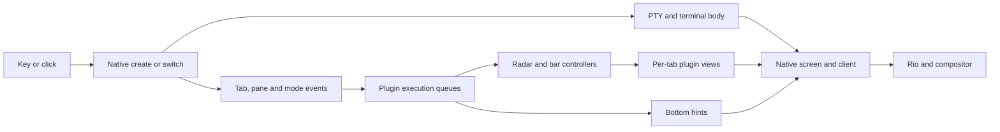

# Nova tab performance

Investigation: 2026-10-12. Owner: `yazelix-5vl-tab-performance-investigation-yia1`.
Scope: the Nova Edge desktop launcher on Linux; investigation and documentation.
The original investigation made no production changes. Its temporary instrumented
plugins remain in the proof directory; the follow-up implementation is below.

## Lightweight mode-event implementation

Follow-up owner: `yazelix-5vl-tab-mode-events-mbhl`. Radar
[`3ad74c18`](https://github.com/Yazelix/zj-radar/commit/3ad74c18e44cf97cdd8c6ea9121f93c5c7135dd0)
and zjstatus
[`8ccf986f`](https://github.com/Yazelix/zjstatus/commit/8ccf986f7d9b9c27f278d618db45d7b05fc95302)
subscribe to `InitialKeybinds` in their stateful roles. The pinned native host
then delivers bindings separately and omits them from frequent mode events.
Both ignore the separate keymap; Bar drops it before its permission queue.
Views, SDK versions, host floor, native keymaps and hints remain unchanged.

Two control/candidate pairs retain all 59 explicit bindings plus native defaults.
Each fresh session creates a second tab and exercises eight numbered, eight
walking and eight click switches. Matching compiler versions are Rust 1.96.0
for Radar and 1.95.0 for Bar; hints use the same original artifact in both.
There are no overlapping heavy builds; one-minute system load is 3.25–3.64
on 16 logical CPUs. Callbacks are instrumented, so these are diagnostic timings.

| Endpoint | Control | Candidate |
| --- | ---: | ---: |
| Settled mode payload, both controllers | 88,936 bytes | 830 bytes |
| Radar settled decode median per run | 72.4–81.7 ms | 0.75–0.78 ms |
| Bar settled decode median per run | 40.1–44.1 ms | 0.74–1.00 ms |
| New-tab body | 158–163 ms | 154–157 ms |
| New-tab correct bar | 416–468 ms | 392–427 ms |
| New-tab Radar | 517–672 ms | 481–502 ms |
| Switch correct-bar medians across kinds/runs | 103–126 ms | 94–114 ms |
| Worst observed correct-bar switch | 212 ms | 167 ms |

Each controller receives a separate keymap at startup and reload; mode events
stay below 1 KB even across style and minor-mode changes. The reloaded Alt+9
binding, Pane/Normal hints and Radar's published session name pass assertions.
The uninstrumented candidate plugins also pass the expanded attached-client
check: full keymap reload, minor modes, click targets at three widths, independent
selection, detach and reattach. Radar's 1,013 tests and Bar's 34 Wasm tests pass.
An initial Radar setup-test failure was caused by OpenCode on PATH; the suite
passes with the expected isolated PATH. Bar binary tests use its Wasm runner.

Raw proof, hashes, commands, event records and analysis:
`/home/lucca/.local/state/codex/proofs/nova-light-mode-20261012.gwbR4tSP`.
Use `candidate-3/4` and `control-3/4` for matched timing comparisons; earlier
controls use a different Bar compiler and are retained only as exploratory proof.
The unchanged hints path and shared-host variation still limit overall gains.
These measurements exercise `enter`, not Rio presentation. Final installed
launcher proof and exact Linux/Darwin acceptance belong in the owning Bead.
The user's existing desktop entry is supplied by Home Manager, not a separately
installed `yazelix-edge` profile element; source changes alone do not refresh it.

## Findings

We reproduced the reported blank UI in a fresh, isolated session using the
installed Edge launcher’s `enter` path. Yazi displayed the new tab’s content in
about 120 ms, while the top bar needed about 1.2 seconds and Radar needed about
1.6–1.7 seconds. The terminal body and the plugin UI have different readiness
times. Measuring only the body hides most of this defect.

Radar contributes to the cost. Disabling its controller and sidebar view reduced
the top-bar delay to 0.5–0.85 seconds in two runs, but left a visible delay.
The server’s plugin execution threads consumed CPU throughout the blank interval.
A native CPU profile places about 91% of sampled user CPU in Wasmi’s interpreter
loop, with most call stacks under plugin event application. Plugin callback work
is the main measured CPU cost during this reproduction.

After startup settled, numbered keys, walking, and clicks also reproduced a gap:
the body usually changed in 20–30 ms, while the correct active tab highlight
sometimes needed about 0.8 seconds. This explains how switching can feel slow
even when native pane switching finishes much sooner.

Callback tracing identifies large mode-event decoding, repeated hints rendering,
and unused compatibility broadcasts. These are small Linux samples on a shared
workstation, not an accepted installed fix. The reproduction bypasses Rio, so
Rio is not required to produce the blank UI; its contribution to the desktop
experience remains unmeasured.

A Radar-only `InitialKeybinds` prototype retains the full keymap and cuts its
mode-event payload from 89,496 to 830 bytes. Settled decoding falls from a
79.2 ms median to 0.75 ms. Overall switch latency remains similar while Bar
and hints retain their expensive paths. This validates a concrete work reduction,
not a complete fix or desktop latency promise.

Further source review found a release-profile mismatch in Nova's native wrapper,
an initialization/render problem in hints, and an existing upstream shared-plugin
API that Nova's plugins do not use. These provide distinct improvement options;
they are not evidence that removing Radar alone will solve the problem.

## Report and observable behavior

The user reports slow tab creation, horizontal walking, numbered switching, and
clicking tabs, and uses the **Nova Edge desktop entry**. The supplied screenshot
shows a running folder picker with 189 entries, a top bar containing `…`, an empty
bottom row, and a sidebar containing only `Radar`.

Our reproduction shows the same intermediate UI with a tiny disposable home and
empty or one-entry directory history. A large zoxide history is therefore not a
prerequisite. This does not exclude extra picker cost with the user’s history.

For this investigation, retain Nova’s existing tab contents, focus policy, Radar,
top-bar interactions, and hints. A successful optimization must shorten the
delay without losing those behaviors. No numerical latency guarantee has been
accepted. Record these endpoints separately:

| Endpoint | Observation | What it does not establish |
| --- | --- | --- |
| Native tab creation | New stable tab/pane IDs exist | Visible content or plugin readiness |
| First terminal body | Target Yazi/picker or unique terminal marker appears | Input echo, correct bar/Radar, GUI presentation |
| First plugin frame | Bar labels, Radar rows, and hints replace placeholders | All three agree with the current selection |
| Completed switch | Target body and active tab highlight agree | Rio/compositor presentation or every sidebar field |
| Input acknowledgement | A harmless input produces its expected response in the target | Not measured in the creation probes |

## Installed artifact

The desktop entry uses an absolute executable path. It does not resolve `yzx`
through the interactive shell’s PATH.

| Surface | Identity at inspection |
| --- | --- |
| Desktop file | `/home/lucca/.nix-profile/share/applications/yzx-edge.desktop` |
| Desktop command | `/nix/store/s44slycskycw0lw8z6v0k7362970mr7w-yzx/bin/yzx launch` |
| Native binary | `/nix/store/y4yr7icvy91268cqjjndjvczblzi3p5m-nova-zellij-distribution-0.1.0/bin/yzx-zellij` |
| Native SHA-256 | `509634058144474e44431d48707cdaf0920694a3f03bba9026c1cbb32f76b3ad` |
| Runtime identity | Nova 1.3.0, channel `edge`, Rio `aead5c08d1d5b8396fedf1038b609144b93cbe4c` |
| Source checkout | `edge`, `9942aeabd160855325806a5fd310ef2de088a225` |

The native hash matches the installed-artifact proof recorded for `15fcdef1`.
The runtime identity file does not itself expose Nova’s full source revision.
Do not infer artifact identity from the current checkout or version number alone.
There is also a portable installation on PATH; these measurements use the Nix
artifact named above.

Read-only inspection of the running Rio session found the default Radar choice
and `/home/lucca/.local/share/yazelix/zellij/config.kdl`, with 371 physical lines
and 50 `bind` lines. The disposable baseline contains 49 `bind` lines. We have
not copied the user’s complete configuration or session into the probes.

## Paths through the system

The bindings in [config.kdl](defaults/zellij/config.kdl) distinguish the triggers:

| Trigger | Owner before the shared native switch/create path |
| --- | --- |
| `Alt Shift T`, tab-mode `n` | Native `NewTab`, installed layout, home cwd |
| `Alt 1`…`Alt 9` | Native `GoToTab` |
| `Alt h/l`, left/right | Pane orchestrator: focus a pane or cross a tab boundary |
| Top-bar tab click | Bar view → bar controller → native action |
| Radar row click | Radar view → Radar controller → native action |
| `Ctrl Tab`, `Ctrl Shift Tab` | Radar cross-session cycling; a separate operation |

Horizontal movement may focus the sidebar before changing tabs. The synthetic
walking check starts in the rightmost work pane and uses `Alt l`, then asserts
the target body. It does not count a successful sidebar focus as a tab switch.

The [layout](defaults/zellij/layout.kdl) creates three plugin panes per tab:
top bar, Radar view, and bottom hints. Background controllers also remain alive.
New tabs start managed Yazi with `--yzx-startup-picker`. The top-level welcome
animation does not run for each new tab.



The observed gap lies between the first body and the completed plugin UI.
The diagram describes ownership, not a claim that these branches execute in
strict sequence.

## Measurements

Proof directory on this workstation:
`/home/lucca/.local/state/codex/proofs/nova-performance-20261012.mtW9Bi5s`.
It contains harness source, CSV samples, configurations, terminal captures,
isolated native logs, and per-thread CPU samples. Raw proofs are local artifacts;
the observations and constraints needed for later work are recorded here.

### Installed launcher, one tab followed by a second tab

The probe starts the exact installed `yzx enter --session perf-launcher` inside
a private tmux server, waits for the first Yazi body, settles for two seconds,
and sends `Alt Shift T`. It isolates HOME, config, state, session cache, sockets,
temporary logs, and directory history. It uses 120×40 terminal cells and captures
the target body and the top bar independently. The temporary socket path stays
below the platform limit. No input or launch touches the user’s desktop/session.

Times below start before sending the key. They include tmux input/capture cost
and polling, so they are observations with measurement overhead.

| Probe | First target body, ms | First bar with tab 2, ms | First Radar rows, ms |
| --- | ---: | ---: | ---: |
| Default, `key-1` | 124 | 1,248 | 1,719 |
| Default, `key-2` | 120 | 1,164 | 1,622 |
| Radar disabled, `key-no-radar-1` | 147 | 852 | Absent |
| Radar disabled, `key-no-radar-2` | 87 | 507 | Absent |
| Keymap reduced after startup, `key-minimal-1` | 137 | 1,089 | 1,511 |
| Keymap reduced after startup, `key-minimal-2` | 141 | 967 | 1,340 |

The first separate reproduction (`launcher-enter`) recorded body 125 ms and bar
1,293 ms. Its quarter-second capture matches the supplied screenshot’s blank
plugin UI. Captures at one, three, and ten seconds distinguish delayed convergence
from a persistent missing view.

Radar-off uses the existing sidebar configuration with `/bin/sleep 9999` in
place of Radar. Nova omits Radar’s controller and view. Geometry remains similar,
but the replacement is a terminal pane, so this is a component ablation rather
than an identical-work comparison. Default/Radar-off order was A–B–B–A.

The keymap experiment rewrites only the disposable native config after startup,
retaining tab creation and two numbered bindings. The bottom-hint capture confirms
reload to `{A} 12 tab {A-S} T new`. Most of the real-launcher delay survives.
This probe does not record payload sizes received by newly loaded instances.
The later trace controls the keymap before the first plugin loads and measures
those sizes directly. Do not propose pruning the user's bindings as the fix.

Single additional new-tab probes, using the installed session’s environment and
a custom layout, recorded:

| Layout variation | First bar, ms | First Radar rows, ms |
| --- | ---: | ---: |
| All three views | 1,321 | 1,433 |
| Omit new tab’s hints | 1,020 | 709 |
| Omit new tab’s Radar view, retain controller | 1,233 | Absent |
| Omit new tab’s bar view, retain controller | Absent | 710 |

These single samples suggest interaction among plugin views and controllers.
They do not isolate one expensive callback. One Radar-view-omitted probe used
the wrong body predicate when the real folder picker opened; its bar observation
survives, but its body latency is excluded.

### CPU during creation

The probe samples `/proc/<own-server-pid>/task/*/stat`; `CLK_TCK` is 100.
These are deltas for the isolated native server, not lifetime `ps` percentages
and not Rio or whole-session CPU. Over the first three seconds after creation:

| Probe | CPU seconds in busiest plugin execution threads |
| --- | --- |
| Default, `key-1` | 1.89 + 1.44; other plugin threads 0.16 + 0.24 |
| Default, `key-2` | 1.80 + 1.33; other plugin threads 0.15 + 0.20 |
| Radar disabled, run 1 | 0.95 + 0.87 + 0.83 |
| Radar disabled, run 2 | 0.47 + 0.52 + 0.76 |

The two busiest baseline workers each accumulate about 0.73 CPU seconds within
the first 0.75 wall seconds. This is evidence of substantial computation during
the gap. Executor threads can host several plugins; their names do not identify
an individual plugin’s CPU share. These measurements do not establish idle CPU.

### CPU profile and completed switching

`profile-full` records a three-second `cpu-clock:u` profile at 199 Hz, attached
only to the disposable server during creation. `perf` captured 795 samples with
zero lost samples. The flat profile puts 53.96%, 30.44%, 3.40%, and 3.27% in
`wasmi::engine::executor::instrs::execute_instrs` on four plugin workers, totaling
91.07% of sampled native user CPU. Call graphs place most of that work under
`apply_event_to_plugin`, with a smaller pipe-message contribution. This identifies
interpreted plugin callback execution; it does not identify the Wasm function or
separate SDK decoding, update logic, and callback-driven rendering.

After ten seconds of convergence, the same session alternates between its two
tabs using numbered keys, `Alt l`, and top-bar clicks. Each observation waits for
both the target body and the correct ANSI-colored active tab label. It leaves
100 ms after completion before the next input. Each method has eight samples:

| Method | Body median / maximum, ms | Correct bar median / maximum, ms |
| --- | ---: | ---: |
| Numbered keys | 19.4 / 28.2 | 338.2 / 833.7 |
| Horizontal walking | 20.8 / 127.5 | 296.8 / 829.1 |
| Top-bar click | 27.9 / 148.2 | 324.2 / 793.0 |

The body and bar columns measure the same inputs. The bar often updates later
when returning to the first tab; the callback trace below identifies extra
controller mode-event delivery in that direction. Queue waiting is unmeasured.
The profiler had finished before this switch series. The host remained busy,
so repeat the series under controlled load before setting a latency target.
The check verifies active-bar selection, not full Radar/hints agreement.

Commands used for the saved proof on this workstation; the probe exercises
`enter` and records native output:

```sh
rustc --edition=2024 /home/lucca/.local/state/codex/proofs/nova-performance-20261012.mtW9Bi5s/profile.rs -o /home/lucca/.local/state/codex/proofs/nova-performance-20261012.mtW9Bi5s/profile
/home/lucca/.local/state/codex/proofs/nova-performance-20261012.mtW9Bi5s/profile /home/lucca/.local/state/codex/proofs/nova-performance-20261012.mtW9Bi5s/profile-full /nix/store/s44slycskycw0lw8z6v0k7362970mr7w-yzx/bin/yzx key-profile
```

The harness uses the repository’s `checks/tmux.rs` and the active-highlight
parser from `checks/attached-tab-focus.rs`. Saved source and the installed store
paths are part of the proof identity. Recheck them before comparing another
revision, and choose a fresh destination when repeating to preserve the proof.
Inspect `perf.stderr` and `PERF_EXIT` instead of assuming profiling
permissions or successful collection on another host.

### Synthetic bodies and more tabs

An earlier matrix uses the installed native binary and config with marker/sleep
terminals instead of Yazi. It compares native-only, Radar-only and bar-only graphs
at 3 and 12 tabs. Each numbered series has 16 observations; creation has four.
Creation uses a native CLI action and measures the first marker, not full UI.

| Graph | Initial tabs | Numbered body switch median, ms | New body median, ms |
| --- | ---: | ---: | ---: |
| Native only | 3 | 20.8 | 61.6 |
| Native only | 12 | 18.7 | 76.8 |
| Radar only | 3 | 20.3 | 59.7 |
| Radar only | 12 | 21.0 | 73.0 |
| Bar only | 3 | 20.5 | 63.1 |
| Bar only | 12 | 20.8 | 69.0 |

Those similar body timings do not clear Radar or the combined plugin graph.
Combined runs switched bodies while the bar still displayed `…`. Early click
samples without a ready bar produced long tails and missing-target assertions;
they are excluded from component comparisons. A longer isolated observation
showed recovery. A synthetic reduced-keymap run also reduced a walking tail,
but neither synthetic body timings nor that post-startup config edit establish
the cost of full payloads in newly loaded plugins.

## Source evidence and competing mechanisms

The investigation reads pinned source, rather than divergent sibling checkouts:

| Component | Pin |
| --- | --- |
| Radar | `9beefdf9a997a9a0b206d40cccc57d4eba76a9de` |
| Pane orchestrator | `f47af17470c70cd9d8b0422222105995d074fc04` |
| Nova Bar | `7295e9976803de8d912f766f1b00ad12652e3e9b` |
| zjstatus used by Bar | `0338e5eaef2316ce6776237ae2c2d17cc4112859` |
| Native Zellij | `333d7898a840314e41d3cc9d2a264a1b9732bb7b`, plus local distribution patches |
| Bottom hints | `709d56292217920a5b7e2702302cd66b60ed6477`, plus local grouping patch |

**Radar has one controller and thin views.** View instances subscribe to mouse
and permission events, not the full state/timer stream. The controller sanitizes
and deduplicates tab updates and gates several snapshot/presence writes.
Its timer adapts between 200 ms animation, one-second bookkeeping, and a
60-second quiet heartbeat. A claim that every tab runs a full polling Radar
engine would contradict this pin.

**Radar still sends frames to registered inactive views.** `publish_views`
renders once per distinct size, then clones and sends a frame to each registered
view. Neither that seam nor view-frame receipt checks equality with the last
frame. Delivery work grows with registered views even when rendering shares a
size cache. View registration and permission/size ordering also matter for the
first frame. See [Radar plugin source](https://github.com/Yazelix/zj-radar/blob/9beefdf9a997a9a0b206d40cccc57d4eba76a9de/crates/plugin/src/lib.rs).

**The top bar has similar fan-out plus a one-second refresh.** Its controller
sets `should_render = true` on each timer event and publishes to all registered
views, sharing rendering by width. `render_frame` clones state/widget maps.
A new bar view prints `…` while its frame is empty and requests a frame after
permission/width readiness. Thus `…` identifies a view without a usable frame;
it does not measure terminal startup. See [zjstatus](https://github.com/Yazelix/zjstatus/blob/0338e5eaef2316ce6776237ae2c2d17cc4112859/src/bin/zjstatus.rs).

**Mode events contain potentially expensive unused keymaps.** Native
`apply_event_to_plugin` includes keybindings in `ModeUpdate` unless the plugin
subscribes to `InitialKeybinds`. Radar and Bar use SDK 0.44.3; Radar consumes only
the session name from this event, and Bar clears keybindings after SDK decoding.
Hints needs the bindings and does not subscribe to `InitialKeybinds` at this pin.
The later callback trace measures this cost directly. `InitialKeybinds` exists
in both installed SDKs, so adopting it does not itself require an SDK upgrade.
Preserve hints' cached bindings across lightweight mode events and refresh them
on configuration changes. The pinned native bridge sends initial bindings and
notifies subscribers again after reconfiguration; this needs a regression check.
See the [event contract](https://zellij.dev/documentation/plugin-api-events.html#initialkeybinds).

**Native pane/tab/mode delivery filters inactive tab plugins.**
`screen.rs::targeted_plugin_ids` selects active-tab plugins and subscribed
background plugins for these events. Controller frame pipes to inactive views
use a different path. The switch path still generates full pane/tab/session
state, reconciles focus, reports plugin metadata, and schedules rendering.

**Session updates still broadcast to all subscribers.**
`log_and_report_session_state` sends `SessionUpdate` without a plugin/client
target. Each hints instance subscribes to it, including on inactive tabs, but
the pinned hints `update` function has no `SessionUpdate` handler. The SDK must
decode the payload before that function can ignore it. This is a concrete
candidate for removing unused work. Its runtime contribution needs measurement;
the active-tab filtering above does not cover this event. Inspect the pinned
[hints source](https://github.com/myah-mitchell/zjhints/blob/709d56292217920a5b7e2702302cd66b60ed6477/src/main.rs)
and Nova’s [local patch](prototypes/zellij-distribution/zjhints-group-modifiers.patch).

**Plugin execution has queues, shared workers, and locks.** Native plugin jobs
run through a pinned executor, with per-plugin locking and up to 16 threads on
this host. Plugin loading holds the plugin map lock while initializing an
instance. Event handling serializes protobuf, calls Wasm, and may render/send
bytes. Some controllers and newly registered views can share a worker. CPU
samples establish pressure here; the later callback trace separates some
event/render work but does not measure lock or queue waiting.
See [native bridge](https://github.com/zellij-org/zellij/blob/333d7898a840314e41d3cc9d2a264a1b9732bb7b/zellij-server/src/plugins/wasm_bridge.rs).

**Orchestrator reconciliation is another boundary, not a universal sleep.**
It joins tab and pane snapshots and has a 500 ms recovery timer. Once ready,
horizontal movement plans and issues the native focus/tab action directly.
Do not describe the timer as a fixed delay on every keystroke. Its status
publication also has equality gates. See [orchestrator](https://github.com/Yazelix/zellij-pane-orchestrator/blob/f47af17470c70cd9d8b0422222105995d074fc04/src/main.rs).

**Yazi has separate startup costs.** [yzx-yazi](runtime/yzx-yazi.rs) queries
configuration, materializes config, checks terminal size, and starts Yazi.
Its size loop has a two-second deadline, not an unconditional two-second sleep.
The [startup picker](defaults/yazi/plugins/quick-search.yazi/main.lua) queries
zoxide and may start fzf. These costs affect creation; they do not explain why
already-rendered picker content precedes several other plugin frames.

## Further findings and improvement options

Upstream's [Wasmtime-to-Wasmi migration](https://github.com/zellij-org/zellij/pull/4449)
traded compilation/cache machinery for interpretation and documented a cost for
compute-heavy plugins. A later [0.44.x issue](https://github.com/zellij-org/zellij/issues/5291)
reports high idle CPU with built-in bars. That report concerns a different
revision and plugin graph; it does not prove Nova has the same bug. Our profile
measures a creation interval, not settled idle behavior.

### Build profiles do not match upstream

The exact installed native derivation uses
`/nix/store/xdxqlfk3fmqh1gg24kkwhv6dn3wjfy5g-zellij-distribution/Cargo.toml`.
That wrapper has no release profile. Upstream's pinned workspace explicitly sets
`lto = true` and `codegen-units = 1`. Cargo ignores profiles in dependencies;
the installed derivation has no profile/Rustflags override. Nova therefore
does not inherit those upstream settings. This is still an optimized release
build, not a debug build. See the [Cargo profile rules](https://doc.rust-lang.org/cargo/reference/profiles.html).

Wasmi recommends fat LTO and one codegen unit for its embedding application.
Its interpreter is generic, so optimizing only the `wasmi` dependency can miss
the code instantiated in its consumer. See the [Wasmi optimization guide](https://github.com/wasmi-labs/wasmi/blob/main/docs/usage.md).

Hints also has no release profile. Radar already has LTO and one codegen unit,
but chooses size optimization (`opt-level = "z"`). Bar already has fat LTO and
one codegen unit. These are different cases; applying the same changes to all
plugins would obscure which setting helps. None of the proposed build-profile
changes has been benchmarked here.

### Callback tracing identifies expensive work

Temporary builds expand each pinned SDK's registration macro to time stdin/JSON
reading, protobuf decoding and event conversion before `State::update`, then
time that update separately. Pipe decoding/handling and render callbacks have
separate timers. The native binary and engine remain installed artifacts; Radar,
Bar and hints load from explicit candidate Wasm files in a disposable graph.
Permission grants and pane URLs identify the actual instances. Config/layout
paths and aliases are explicit. No compiled candidate was installed for the user.

These are elapsed callback times, including host calls and scheduling, not CPU
samples or enqueue-to-start times. Instrumentation adds clock/logging overhead;
file-plugin loading and worker assignment can differ from embedded plugins.
Use the trace to identify work, not to claim an absolute desktop speedup.

`plugins-trace-full-2` records an **89,496-byte protobuf ModeUpdate** each time
the full mode/keybind payload is delivered. During its first three seconds:

| Consumer | Calls | Decode/conversion per call, ms | Plugin update per call, ms |
| --- | ---: | ---: | ---: |
| Radar controller | 2 | 87.6–119.9 | 2.20–2.29 |
| Bar controller | 2 | 38.5–43.6 | 1.34–1.46 |
| Hints, both tabs | 4 | 46.8–72.7 | 0.005–6.69 |

The separate `plugins-trace-1` observes Radar decoding 140.1 ms before a 2.3 ms
update. Radar consumes only the session name, and Bar discards the decoded
keybindings. Optimizing agent classification alone would miss this cost.

In the full second trace, hints performs **33 renders** during those three
seconds, taking 620 ms in aggregate across its two instances. During 24 settled
switches it performs another 216 renders. Their median durations are 12.5 and
17.1 ms for the two instances. These sums can overlap across workers and are
not the critical-path wall time.

The switch trace also explains the observed direction asymmetry: returning to
tab 1 delivers full mode events to hints, Radar's controller and Bar's controller;
switching to tab 2 delivers one to its hints instance. Native tab activation
reports mode information to that tab's plugin IDs, including suppressed panes.
The controllers are suppressed panes associated with tab 1 in this graph. This
is a narrower observation than claiming every background event reaches every
tab's plugins.

A diagnostic with three binding rules configured **before startup** reduces
that payload to 1,582 bytes. Settled mode-event decoding medians change from
79.2 to 4.5 ms for Radar, 42.9 to 1.3 ms for Bar, and roughly 58–60 to 1.8–2.1 ms
for hints. Hints render medians fall to about 1.4 ms because the hint catalog is
also smaller. Correct-bar switch medians across numbered/walking/click methods
are 111–122 ms with the full map and 40–41 ms with the diagnostic map.

This is one instrumented run per map, with eight switches per method. It proves
the payload/catalog is expensive in this environment; it does not isolate
decoding from hint generation or retain the user's full keymap. Production
should deliver/cache bindings through `InitialKeybinds` and avoid rebuilding
unchanged hints while preserving all bindings. The earlier post-startup keymap
probe is not sufficient to reject this mechanism.

Saved proof: `plugins-trace-full-2`, `plugins-trace-min-2`,
`plugins-trace-analysis.json`, `analyze-plugin-trace.py`, candidate sources,
locked build logs and Wasm artifacts. `plugins-trace-1/native.log` ends at its
ten-second snapshot and supports creation timing only; the later trace saves
logs after the switch series too.

### Full-keymap Radar prototype

A separate temporary Radar build changes only the controller's subscription to
include `InitialKeybinds`, retaining its trace instrumentation. The current
0.44.3 SDK compiles it without an upgrade. The installed native host sends the
full keymap once and omits it from subsequent mode events. Radar does not use
the map. The full configuration, Bar and hints remain unchanged.

`plugins-trace-radar-keybinds-1` verifies an 830-byte Radar mode event while
Bar and hints still receive 89,496 bytes. Across 12 settled Radar mode callbacks,
median decode/conversion is 0.75 ms, compared with 79.2 ms in the full-map
control; its update median is 0.020 ms. Both runs exercise 24 switches across
numbered keys, walking and clicks. Body and correct-bar assertions pass, and
pane metadata identifies the actual candidate.

Correct-bar switch medians remain 114–131 ms versus 111–122 ms in the control.
Creation records body 159 ms, Bar 433 ms and Radar 492 ms. This is one run per
variant, not a latency acceptance. It shows that removing Radar's repeated
decode work is insufficient while Bar/hints retain theirs. Initial keybind
delivery still costs work once, and reload, cross-session and multi-client
behavior have not been dogfooded. Saved original/candidate Wasm files and source
delta preserve the comparison in the proof directory.

### Hints requests renders until a mode change

The installed hints source starts `update` with `should_render = !initialized`.
Its render function sets `initialized` only when it has nonempty output and
the current mode differs from the base mode. A normal-mode session can therefore
keep that flag false even after showing valid hints. Ignored session updates
then request another render. This is direct source evidence, separate from the
cost of decoding their unused payloads.

A disposable prototype removes the unused subscription and marks hints ready
when keybindings are available. Its control is the same pinned, locally built
source without those two changes. Both use the same Rust toolchain, release
profile, permission grants, layout and native binary. Each fresh session runs
the installed `enter` launcher with an explicit test layout; creation uses a
native CLI action. Both tabs use the candidate Wasm file, verified through pane
metadata, and the initial capture contains working hints rather than a permission
prompt. These are plugin experiments, not installed-distribution acceptance.

| Order | Hints variant | New body, ms | Bar, ms | Radar, ms |
| --- | --- | ---: | ---: | ---: |
| A1 | Original | 172 | 1,150 | 1,235 |
| B1 | Ready flag + no session subscription | 175 | 1,070 | 1,296 |
| B2 | Ready flag + no session subscription | 152 | 336 | 411 |
| A2 | Original | 157 | 1,407 | 1,525 |

The modification does not consistently remove the gap. Correct-bar switching
medians across the three input methods were 244–278 ms in the controls,
212–231 ms in B1, and 93–100 ms in B2, with eight observations per method/run.
Keep the improvement as a candidate; do not claim a reliable percentage from
two variable runs. Individual effects of the two changes remain unseparated.
Proof: `hints-ablation-summary.json` and the four `hints-valid-*` directories.
Earlier permission/fixture failures are excluded; one control's final log-count
assertion was replaced by a successful pane-metadata check because module-cache
reuse does not emit a second module-load line.

### Unused hints broadcasts amplify rendering

Hints' default render publishes the same output under both `zjhints` and
`zjstatus_hints` compatibility pipe names. These messages have no destination
plugin ID. Nova displays hints directly in a pane and its bar configuration
consumes neither pipe. Nevertheless, Bar's pipe parser stores every received
value and returns `true`, including unchanged values for unused pipes. The
controller then publishes frames to all registered views. Radar and the view
instances also decode the broadcasts before ignoring them.

In `plugins-trace-1`, the first three seconds include 30 hints renders, 63 pipe
deliveries each to Radar and Bar's controllers, and 270 deliveries to the two
Bar views. Those views perform 145 renders. The source explains the amplification:
two broadcasts per hints render, then additional controller-to-view frames.
This path can grow with inactive tabs; no large-tab scaling claim is measured
by this two-tab trace.

Disabling publication in a temporary hints build retains its visible pane,
keybindings, initialization behavior and session subscription. This isolates
the unused compatibility output from the earlier readiness/subscription changes.
The ordinary child default must remain available for users who consume those
pipes; Nova needs an explicit opt-out rather than silently changing their
contract. Alternatively, rejecting unchanged/unused pipe values in Bar reduces
republication but leaves broadcast decoding elsewhere.

The original control and no-broadcast candidate ran in A–B–B–A order:

| Order | Hints variant | New body, ms | Bar, ms | Radar, ms |
| --- | --- | ---: | ---: | ---: |
| A1 | Original | 157 | 1,407 | 1,525 |
| B1 | No compatibility broadcasts | 164 | 387 | 444 |
| B2 | No compatibility broadcasts | 160 | 1,249 | 1,336 |
| A2 | Original | 166 | 669 | 1,082 |

Correct-bar switch medians across the three methods were 242–278 ms in the
controls, 111–124 ms in B1, and 254–282 ms in B2. This change removes a confirmed
unused message path, but these timings do not establish a consistent latency
improvement or a complete fix. Shared-host load and executor assignment remain
confounders. Proof: `hints-broadcast-ablation-summary.json`,
`hints-no-broadcast-{1,2}`, and `hints-valid-base-{3,4}`.

### Upstream already owns shared plugin instances

Zellij merged [resource usage optimizations, PR #5662](https://github.com/zellij-org/zellij/pull/5662)
on 2026-09-28, before Nova's 2026-10-09 native pin. That pin contains
`ZellijSharedPlugin`, `register_shared_plugin!`, slots and client context.
The native host deduplicates equal mode/tab/pane events before calling a shared
instance, merges render requests, and renders visible slot/client targets.
The implementation is in pinned `zellij-tile/src/lib.rs` and
`zellij-server/src/plugins/shared.rs`.

Radar and Bar currently implement their own controller/view fan-out; hints is
instantiated per tab. They do not opt into this API. Updating the native pin
alone therefore cannot remove their instances or message protocol. Migrating
a plugin could replace that protocol with native slot ownership. This requires
SDK and child compatibility decisions, not just a layout flag. Radar's declared
0.44.3 host floor cannot silently be dropped.

There is also a decoder difference: the legacy registration macro parses a
JSON array of protobuf bytes, then decodes and converts the event. The current
shared macro uses `protobuf_bytes_from_stdin` and `event_from_protobuf_bytes`
instead. A newer SDK alone leaves the legacy macro path in place. Measure any
decoder benefit separately from instance deduplication and render batching.

### Options, in the order I would evaluate them

| Option | Owner and concrete change | Expected value | Cost and proof boundary |
| --- | --- | --- | --- |
| Remove avoidable plugin work | Adopt `InitialKeybinds` in Radar/Bar and cache bindings/derived output in hints; opt Nova out of unused broadcasts and fix readiness/subscriptions | Addresses measured decoding and render amplification while retaining the UI | Small to medium child/integration changes. Radar-only prototype confirms payload/decode reduction, not overall latency. Preserve reload, nested sessions and compatibility-pipe consumers. |
| Restore native release optimizations | Nova distribution wrapper: LTO and one codegen unit; separately try the same for hints | Addresses the interpreter that dominates sampled CPU; preserves features | Small source change, slower builds/linking. Benchmark exact artifacts; no measured speedup yet. |
| Adopt native shared instances | Migrate one expensive plugin to `ZellijSharedPlugin`; delete its controller/view protocol when equivalent | Removes per-tab Wasm initialization, frame messages and duplicate state delivery through an existing host owner | Medium to large child change. Prove client-local selection, slot lifecycle, resize, click targets and compatibility policy. |
| Reduce legacy frame fan-out | Radar/Bar: skip unchanged frames, use visibility, refresh immediately on activation | Less pipe decoding and rendering, especially with many tabs | Medium. Equality must include interaction targets. Prove first frame, activation and multiple clients. Avoid building a second visibility owner if migrating to shared instances. |
| Upgrade Wasmi | Native Zellij: evaluate Wasmi/WASI 2.x with correct features | Faster interpreter without replacing the plugin model | Medium upstream/fork work. Nova pins 1.1.0; migration is not a version-only edit. Upstream benchmark gains do not predict Nova latency. |
| Use a smaller UI graph | Existing configuration can replace Radar; optionally evaluate omitting hints | Immediate reduction in plugin work | Loses visible functionality. Radar-off still left 0.51–0.85 s bar delay. This is a user-selected tradeoff. |
| Compiled Wasm engine | Native host: evaluate Wasmtime with build-time compilation or caching | Potentially reduces sustained callback execution cost | Large engine, packaging and maintenance change. Keep behind evidence from the cheaper options. |

The [Wasmi 2.0 release](https://github.com/wasmi-labs/wasmi/releases/tag/v2.0.0)
reports roughly 2.2× geometric-mean execution improvement on its benchmark suite.
Its [migration guide](https://github.com/wasmi-labs/wasmi/blob/v2.0.0/docs/migration-v1-to-v2.md)
covers changed resource limits, WASI and feature selection. Nova's native
dependency disables default features; a migration must deliberately retain
validation and select the intended dispatch path. No Wasmi 2.x Nova candidate
has been built or measured.

Wasmtime documents [precompilation](https://docs.wasmtime.dev/examples-pre-compiling-wasm.html)
and [caching/Winch](https://docs.wasmtime.dev/examples-fast-compilation.html)
as ways to control compilation latency. Precompiled artifacts require matching
engine configuration and trusted provenance; external plugins need an explicit
loading policy. This would enlarge the native fork and require Linux/macOS
delivery proof. A general engine benchmark is not proof that this change beats
fixing redundant callbacks in Nova.

My preferred sequence is removal of repeated keymap/hint work and unnecessary
broadcasts, a separate build-profile comparison, then a one-plugin
shared-instance prototype.
Retain UI behavior and compare against the same full graph. Defer a new native
renderer, extra executor threads, fixed sleeps, and an engine replacement until
the trace shows why the existing mechanisms cannot meet the chosen latency goal.

## Next experiment and decision boundary

Callback decoding, update logic and rendering are now separated in temporary
plugins. The next implementation experiment should retain the full keymap and
UI: adopt `InitialKeybinds`, cache derived hints, and remove unused publication
and subscriptions. Compare each change before combining them. Test keymap reload,
minor modes, nested sessions, permission startup, tab closure and multiple clients
as well as creation and all three switch methods. Build-profile and engine tests
need separate exact-artifact comparisons so their effects remain distinguishable.

The remaining trace gap is native queue waiting and presentation. Correlate
action receipt, plugin enqueue/start/end, worker/lock waiting, view registration,
frame send/receipt and client output using stable IDs and monotonic timestamps.
Use private Kinestra for Rio presentation. Do not interpret elapsed callback
sums as critical-path wall time or add threads before measuring contention.

Repeat paired comparisons at 1, 3, 12 and a representative larger tab count,
including rapid inputs during convergence. Check warm switches separately from
new tabs. Then extend to long-lived and busy-agent sessions. If frame fan-out
remains expensive, compare a one-plugin shared-instance prototype with legacy
frame equality/visibility gating; avoid two owners for visibility and client state.

A candidate needs a full installed-launcher comparison with body, correct
plugin frames, and input acknowledgement. Desktop presentation requires
`launch` through private Kinestra; `enter` proves a narrower surface. Shared
runtime changes still require the repository’s Linux and Darwin gates.

## Limits and excluded evidence

- Host: 16 logical CPUs, approximately 31 GiB RAM, tmux 3.4, Rust 1.96.0.
  Other agent/build/desktop work ran concurrently. Absolute timings and small
  differences need repetition under controlled load; no p95 or p99 claim follows.
- Tests used disposable state and small histories. The user’s long-lived session,
  many projects, agent activity, and actual tab count remain unmeasured.
- Terminal captures prove native output, not the instant Rio presents pixels.
  No GUI automation, desktop launch, Darwin measurement, full native distribution
  rebuild, or user installation update was performed. Temporary Wasm release
  builds support experiments only.
- Shared `/tmp` logs contained top-bar panics, but the isolated reproductions
  have no corresponding crashes. They do not establish the cause of this report.
- The first synthetic harness counted an intentional one-second attachment
  settling delay in `STARTUP`. Those values are excluded from startup claims.
  An early “native-only” attempt retained the inline bar controller and is
  labeled invalid in the proof directory.

No production optimization has been installed or accepted, and no promotion
follows from this report.
